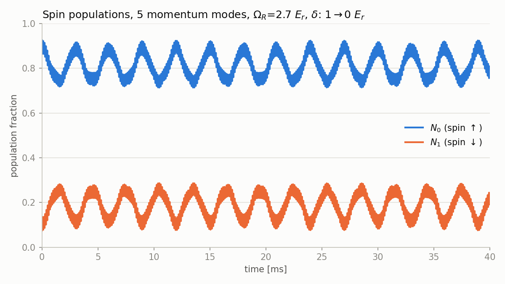

# discrete-states-code

Numerical simulation of a **spin-orbit coupled two-component Bose-Einstein
condensate in a 1D optical lattice**, using a truncated basis of discrete
momentum modes (mean-field / Gross-Pitaevskii dynamics).

The code:

1. finds the minimum of the lowest band by scanning the quasi-momentum `k`
   (imaginary-time evolution at each `k`),
2. prepares the interacting ground state at that minimum,
3. ramps the Raman detuning `δ` and the lattice depth `Ω_L` linearly, and
   evolves the state in real time,
4. records the population of each spin component, `N0(t)` and `N1(t)`.

Author: Federico Serrano, Department of Physics and Astronomy, Washington State University.



## Quick start

The easiest way to run it is with [pixi](https://pixi.sh), which installs
Python and all dependencies in a local environment:

```bash
git clone https://github.com/serranolio/discrete-states-code.git
cd discrete-states-code
pixi run example
```

This runs the default simulation and saves the plot above to
`examples/quickstart.png`. A precomputed result for the default parameters is
in `data/`, so the first run only needs to plot it. To recompute it from
scratch (about one minute):

```bash
pixi run example --recompute
```

### Without pixi (pip)

```bash
python -m venv .venv
source .venv/bin/activate        # Windows: .venv\Scripts\activate
pip install -e .
python examples/quickstart.py
```

## Command-line usage

Every model parameter can be set from the command line:

```bash
pixi run simulate --k-modes 7 --delta-f 0.5 --simulation-time-ms 20
# or, inside an environment where the package is installed:
discrete-states --help
```

Results are written to `data/output/` as a CSV with the columns
`time_ms, N0, N1`. The ground state is cached in `data/input/` as a `.npy`
file. File names encode the parameters, and a simulation whose output file
already exists is loaded rather than rerun (`--recompute` overrides this).

## Use from Python

```python
from discrete_states_code.run_simulation import Parameters, run

df = run(Parameters(k_modes=7, delta_f=0.5))
print(df.head())
```

## Parameters

Energies are in units of the recoil energy `E_r = h·f_recoil` and momenta in
units of the recoil momentum. Times in the CLI are given in milliseconds.

| Parameter            | Default  | Description                              |
|----------------------|----------|------------------------------------------|
| `f_recoil`           | 1960     | Recoil frequency [Hz]                    |
| `gn`                 | 0.6568   | Mean-field interaction energy [E_r]      |
| `k_modes`            | 5        | Number of momentum modes kept            |
| `omega_l_i`          | 0.2      | Initial lattice depth [E_r]              |
| `omega_l_f`          | 0.2      | Final lattice depth [E_r]                |
| `delta_i`            | 1.0      | Initial Raman detuning [E_r]             |
| `delta_f`            | 0.0      | Final Raman detuning [E_r]               |
| `omega_r`            | 2.7      | Raman coupling [E_r]                     |
| `ramp_time_ms`       | 0.01     | Duration of the linear ramp [ms]         |
| `simulation_time_ms` | 40       | Total evolution time [ms]                |
| `frames`             | 1000     | Number of saved time points              |

The lattice wave vector is derived from the Raman coupling as
`k_L = sqrt(1 - Ω_R²/16)`.

## Model

In the basis of `k_modes` plane waves `q_n = k + 2 k_L (n - (k_modes-1)/2)`
for each spin component, the single-particle Hamiltonian is

```
H_0 = (q - σ_z)²  −  (δ/2) σ_z  +  (Ω_R/2) σ_x  −  (Ω_L/2) · (nearest-neighbour coupling in q)
```

and the mean-field interaction `H_I(ψ)` couples momentum modes through the
density with strength `gn`. The real-time dynamics solve
`i dψ/dt = [H_0(t) + H_I(ψ)] ψ` with `scipy.integrate.solve_ivp`.

The module also contains `lmg_simulation`, a two-mode
(Lipkin-Meshkov-Glick type) model for `S_z` and the relative phase `θ`,
for comparison with the full mode simulation.

## Repository layout

```
├── src/discrete_states_code/
│   └── run_simulation.py   # model, solvers and CLI
├── examples/
│   └── quickstart.py       # run + plot example
├── data/
│   ├── input/              # cached ground states (.npy)
│   └── output/             # simulation results (.csv)
├── pyproject.toml          # package metadata, dependencies, pixi tasks
└── LICENSE
```

## License

Released under the [MIT License](LICENSE).
